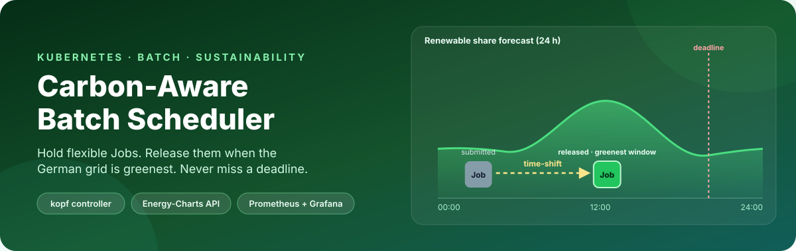
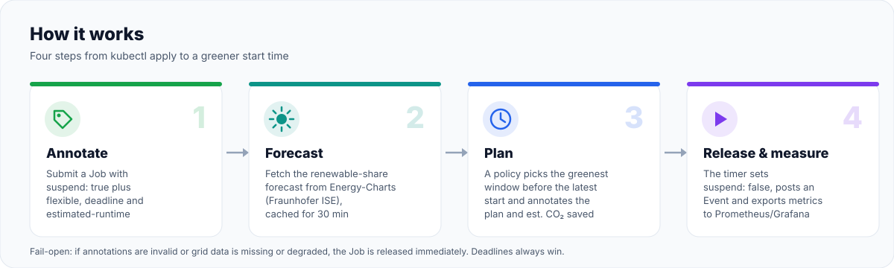
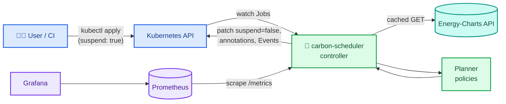

<p align="center">
  
</p>

<p align="center">
  <a href="https://github.com/mahmudul-islam32/carbon-aware-k8s-scheduler/actions/workflows/ci.yml"></a>
  
  
  
  
  
</p>

A Kubernetes controller, written in Python with [kopf](https://github.com/nolar/kopf), that holds back flexible batch workloads such as ML training and ETL and releases them when the German electricity grid is greenest. It reads the renewable-share forecast from the public [Energy-Charts API](https://api.energy-charts.info/) run by Fraunhofer ISE, picks a start window within each Job's deadline, and estimates how much CO₂ was avoided compared with starting the Job right away. A Grafana dashboard shows the result.

## Why

The carbon intensity of the German grid swings widely over a day as solar and wind output changes. Many batch jobs, like nightly ETL, model training or report generation, have slack: they need to finish *by* a deadline, not start *now*. Moving them in time is a cheap way to cut emissions without new hardware.

<p align="center">
  
</p>

## Features

| | Feature | Status |
|---|---|:---:|
| 🏷️ | **Opt-in by annotation:** mark a `batch/v1` Job flexible with a deadline and runtime | ✅ |
| ⏸️ | **Suspend and release** with the native `spec.suspend` field; no custom scheduler binary | ✅ |
| 🌤️ | **Energy-Charts client** with caching, `Retry-After` handling and degraded-data detection | ✅ |
| 🧮 | **Policies:** `immediate`, `threshold`, `greenest-window` | ✅ |
| 🛟 | **Deadline guarantee and fail-open:** no data, bad data or a tight deadline → release now | ✅ |
| 🎛️ | **Per-job overrides** for policy, threshold and max delay | 🆕 |
| ⏱️ | **Max-delay cap** so no Job is parked for days | 🆕 |
| 🌱 | **Live CO₂ estimate** per Job from its CPU/GPU requests, written as an annotation | 🆕 |
| 📣 | **Kubernetes Events** visible in `kubectl describe job` | 🔁 |
| 📈 | **Prometheus metrics, Grafana dashboard, `/healthz` and `/readyz`** | ✅ 🆕 |
| 🔮 | **`carbon-sim plan`:** dry-run a Job against the live forecast | 🆕 |
| 🧪 | **`carbon-sim backtest`:** replay months of grid data against a job trace | ✅ |
| 📦 | **Helm chart** with least-privilege RBAC, ServiceMonitor and dashboard | ✅ |
| 🚀 | **Release pipeline:** a `v*` tag publishes a multi-arch image and an OCI Helm chart on GHCR | 🆕 |
| 🗓️ | Relative deadlines, re-planning, admission webhook, HA, KEDA mode and more | [Roadmap](docs/FEATURES.md#backlog) |

👉 The full catalogue with user stories, acceptance criteria and the roadmap is in **[docs/FEATURES.md](docs/FEATURES.md)**.

## Quick start

Prerequisites: `kubectl`, Helm 3.8+, and internet access to `api.energy-charts.info`.

Install a published release (multi-arch image and chart on GHCR):

```bash
helm install carbon-scheduler oci://ghcr.io/mahmudul-islam32/charts/carbon-scheduler --version <version>
```

Or build from source on a local `kind` (or `k3d`) cluster with Docker:

```bash
kind create cluster --name carbon
docker build -t carbon-scheduler:dev .
kind load docker-image carbon-scheduler:dev --name carbon
helm install carbon-scheduler ./charts/carbon-scheduler \
  --set image.repository=carbon-scheduler --set image.tag=dev
```

Submit a flexible Job (set the deadline a few hours in the future):

```yaml
apiVersion: batch/v1
kind: Job
metadata:
  name: nightly-etl
  annotations:
    carbon-scheduler.mahmudul-islam32.github.io/flexible: "true"
    carbon-scheduler.mahmudul-islam32.github.io/deadline: "2026-11-02T06:00:00+01:00"
    carbon-scheduler.mahmudul-islam32.github.io/estimated-runtime: "2h"
spec:
  suspend: true   # submitted suspended; the controller releases it
  template:
    spec:
      restartPolicy: Never
      containers:
        - name: etl
          image: busybox:1.36
          command: ["sh", "-c", "echo running && sleep 60"]
          resources:
            requests:
              cpu: "4"
```

Then see what the controller decided:

```bash
kubectl describe job nightly-etl     # Events: JobHeld / JobReleased / FallbackRelease
kubectl get job nightly-etl -o jsonpath='{.metadata.annotations}' | jq
```

### Try the planner without a cluster

```bash
pip install -e .
carbon-sim plan --runtime 2h --within 12h --cpu 4
```

## Job annotations

All keys use the prefix `carbon-scheduler.mahmudul-islam32.github.io/`.

| Key | Set by | Example | Meaning |
|---|:---:|---|---|
| `flexible` | you | `"true"` | Opt in |
| `deadline` | you | `"2026-11-02T06:00:00+01:00"` | Job must finish by this time (ISO 8601) |
| `estimated-runtime` | you | `"2h"`, `"1h30m"` | Used to size the window |
| `policy` | you, optional | `"threshold"` | Override the controller-wide policy |
| `renewable-threshold` | you, optional | `"70"` | Override the threshold for `threshold` |
| `max-delay` | you, optional | `"8h"` | Never hold longer than this after submit |
| `planned-start` | controller | ISO 8601 | When the Job will be released |
| `latest-start` | controller | ISO 8601 | Release no later than this (deadline or max-delay) |
| `expected-renewable-share` | controller | `"79.5"` | Mean forecast share in the planned window |
| `co2-avoided-grams` | controller | `"22.10"` | Estimated CO₂ avoided vs starting now |
| `policy-used`, `fallback-reason`, `actual-start` | controller | | Audit trail |

## Architecture



More detail is in [docs/ARCHITECTURE.md](docs/ARCHITECTURE.md).

## Configuration

Environment variables (Helm: `config.*` in [`values.yaml`](charts/carbon-scheduler/values.yaml)).

| Variable | Default | Description |
|---|---|---|
| `CARBON_POLICY` | `greenest-window` | `immediate`, `threshold` or `greenest-window` |
| `CARBON_RENEWABLE_THRESHOLD_PCT` | `60` | Threshold policy: release when the forecast share is at or above this value |
| `CARBON_MAX_DELAY` | `24h` | Longest a Job may be held after submission (`""` disables) |
| `CARBON_DEADLINE_SAFETY_MARGIN_MINUTES` | `5` | Buffer before the deadline |
| `CARBON_GRID_COUNTRY` | `de` | Energy-Charts country code |
| `CARBON_FORECAST_REFRESH_MINUTES` | `30` | Forecast cache TTL |
| `CARBON_RECONCILE_INTERVAL_SECONDS` | `60` | Release timer interval |
| `CARBON_FOSSIL_INTENSITY_GCO2_KWH` | `400` | Intensity of the non-renewable share (CO₂ estimate) |
| `CARBON_WATTS_PER_CPU_CORE` / `CARBON_WATTS_PER_GPU` | `10` / `200` | Job power model (CO₂ estimate) |
| `CARBON_EMISSION_FACTORS_FILE` | `config/emission_factors.yaml` | gCO₂/kWh per production type |
| `CARBON_METRICS_PORT` | `9090` | `/metrics`, `/healthz`, `/readyz` |
| `CARBON_LOG_LEVEL` / `CARBON_LOG_FORMAT` | `INFO` / `json` | Logging |

## Development

```bash
pip install -e ".[dev]"
ruff check src tests
mypy src
pytest
```

CI runs the same checks plus a version-sync check, `helm lint` and a Docker build on every pull request.

### Releasing

`carbon_scheduler.__version__` is the single source of the version; `pyproject.toml` reads it and
`Chart.yaml` is kept equal to it.

```bash
python -m carbon_scheduler.release bump 0.2.0   # updates __init__.py and Chart.yaml
python -m carbon_scheduler.release check        # fails on drift (also runs in CI)
# merge the bump, then:
git tag v0.2.0 && git push origin v0.2.0
```

The tag runs [`release.yml`](.github/workflows/release.yml): it pushes `ghcr.io/mahmudul-islam32/carbon-scheduler:0.2.0`
(`linux/amd64`, `linux/arm64`), pushes the chart to `oci://ghcr.io/mahmudul-islam32/charts`, and creates a
GitHub Release with notes generated from Conventional Commits.

## Data attribution

Grid data comes from **Energy-Charts.info** (Fraunhofer ISE), licensed under CC BY 4.0. The API does not publish a carbon-intensity series. All CO₂ figures in this project are *estimates* derived from the published renewable share or generation mix and documented emission factors.

## Contributing

Pick an item from the [roadmap](docs/FEATURES.md#backlog). Each has acceptance criteria you can turn into tests. Conventions: feature branches named after the feature ID (`feat/F-22-relative-deadlines`), Conventional Commits, and green CI.

## License

Released under the [MIT License](LICENSE). Copyright (c) 2026 Mahmudul Islam.

## Author

**Mahmudul Islam** · M.Sc. Computer Science · [github.com/mahmudul-islam32](https://github.com/mahmudul-islam32)
