<p align="center">
  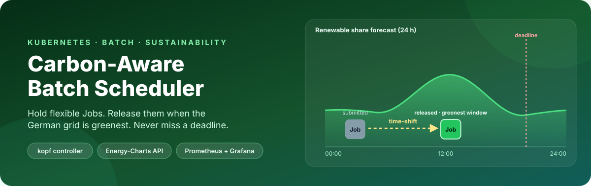
</p>

<p align="center">
  <a href="https://github.com/mahmudul-islam32/carbon-aware-k8s-scheduler/actions/workflows/ci.yml"></a>
  
  
  
  
  
  
</p>

<p align="center">
  <b>Cut the CO₂ of your batch jobs by ~20 % without new hardware.</b><br>
  A Kubernetes controller that holds back flexible Jobs (ML training, ETL, reports) and releases them<br>
  when the grid is greenest, always before their deadline.
</p>

<p align="center">
  <a href="#-see-it-in-action">Demo</a> ·
  <a href="#-try-it-in-30-seconds">Try it</a> ·
  <a href="#-results">Results</a> ·
  <a href="#-features">Features</a> ·
  <a href="#-quick-start-on-kubernetes">Install</a> ·
  <a href="docs/FEATURES.md">Docs</a>
</p>

---

## 🎬 See it in action

<p align="center">
  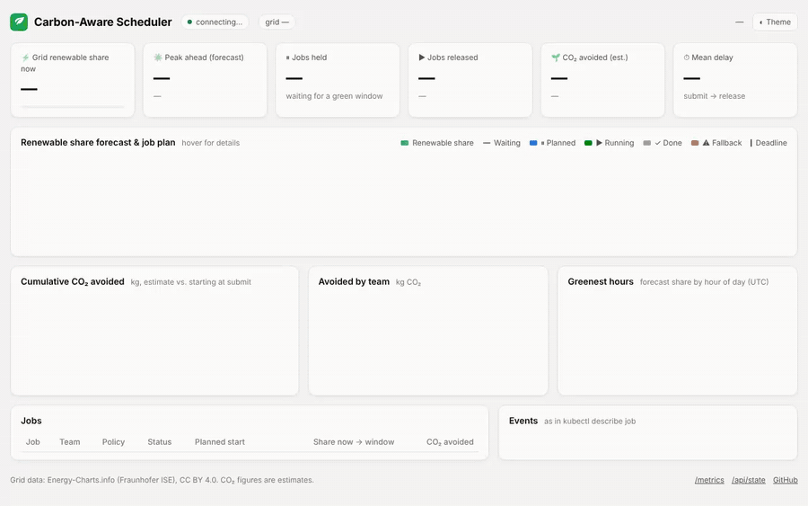
</p>

<p align="center">
  <a href="docs/media/dashboard-demo.mp4"><b>▶ Watch the full-quality video (MP4)</b></a>
</p>

The built-in dashboard during a simulated sunny June day. Jobs arrive through the morning, **wait for the solar peak**, run inside it, and the CO₂ counter steps up as each one is released. Every decision is made by the real planner. The dashboard is served by the controller itself, needs no Grafana and works in air-gapped clusters.

## ⚡ Try it in 30 seconds

No cluster needed:

```bash
pip install -e .
carbon-sim dashboard        # live dashboard on a simulated cluster → http://127.0.0.1:8080
carbon-sim showcase         # 30-day backtest of every policy → showcase/report.html
```

## Why

The carbon intensity of the German grid swings widely over a day as solar and wind output changes. Many batch jobs have slack: they need to finish *by* a deadline, not start *now*. Shifting them in time is one of the cheapest ways to cut emissions: no new hardware, no code changes, three annotations.

<p align="center">
  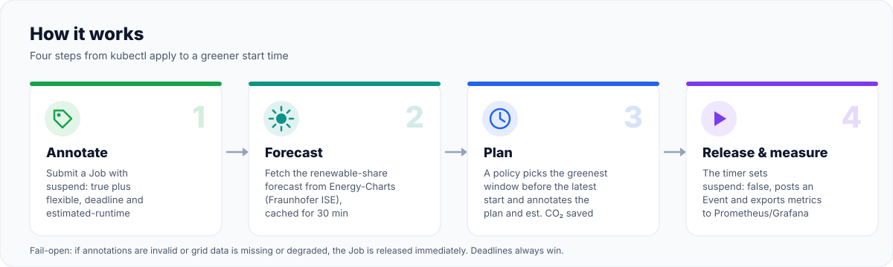
</p>

It reads the renewable-share forecast from the public [Energy-Charts API](https://api.energy-charts.info/) by Fraunhofer ISE, picks a start window within each Job's deadline, uses Kubernetes' native `spec.suspend` to hold and release it, and estimates the CO₂ avoided compared with starting right away.

## 📊 Results

`carbon-sim showcase` replays 300 jobs (30 min to 3 h, 2–12 h of slack) over 30 days of grid data with every policy. Same jobs, same energy, **zero missed deadlines**:

| Policy | Mean delay | Renewable share while running | CO₂ | Saved vs. immediate |
|---|---:|---:|---:|---:|
| `immediate` (baseline) | 0 | 56.5 % | 12.51 kg | — |
| `threshold` (≥ 60 %) | 3.1 h | 61.9 % | 10.81 kg | **13.6 %** |
| `greenest-window` | 3.7 h | 67.6 % | 9.58 kg | **23.4 %** |
| `balanced` (2 pts/h) | **2.3 h** | 66.4 % | 9.87 kg | **21.1 %** |

The new `balanced` policy keeps 90 % of the maximum saving with 38 % less waiting.

<p align="center">
  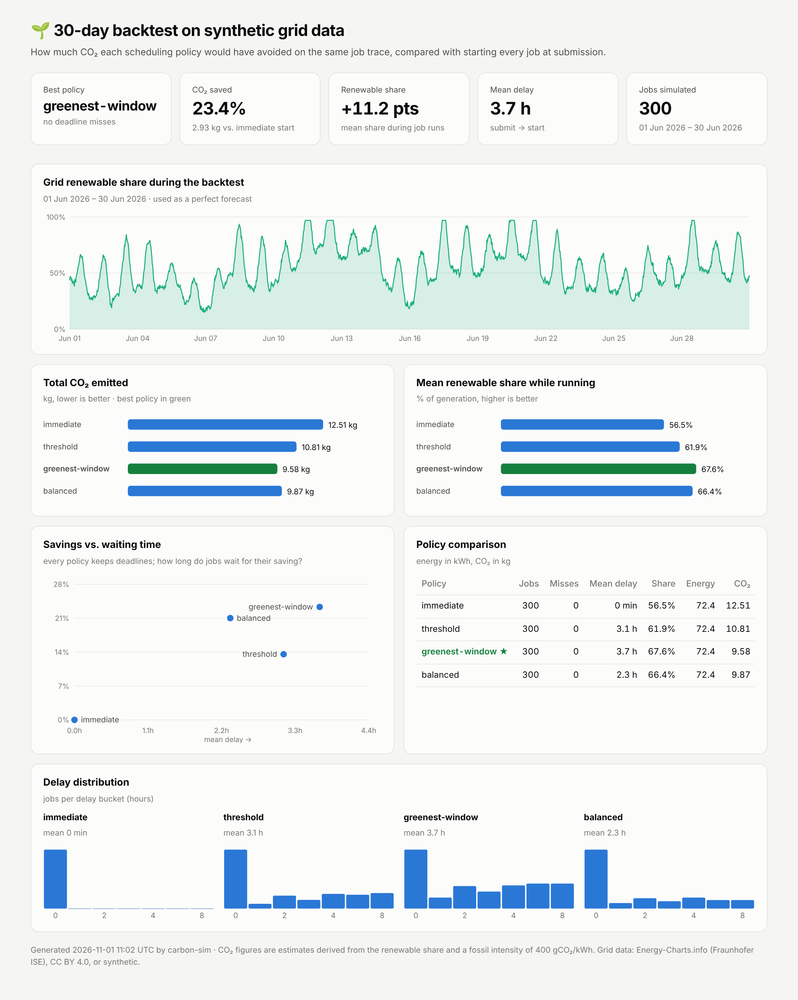
</p>

> Numbers come from synthetic grid data (`carbon-sim synth`), so anyone can reproduce them offline. Run `carbon-sim fetch` plus `carbon-sim backtest` to repeat this on real Energy-Charts history. All CO₂ figures are estimates (see [Data attribution](#data-attribution)).

## ✨ Features

| | Feature | Status |
|---|---|:---:|
| 🏷️ | **Opt-in by annotation:** mark a `batch/v1` Job flexible with a deadline and runtime | ✅ |
| 🗓️ | **Relative deadlines** (`deadline-in: "6h"`), so CronJobs work out of the box | 🆕 |
| ⏸️ | **Suspend and release** with the native `spec.suspend` field; no custom scheduler binary | ✅ |
| 🌤️ | **Energy-Charts client** with caching, `Retry-After` handling and degraded-data detection | ✅ |
| 🧮 | **Four policies:** `immediate`, `threshold`, `greenest-window` and the new delay-aware **`balanced`** | ✅ 🆕 |
| 🛟 | **Deadline guarantee and fail-open:** no data, bad data or a tight deadline → release now | ✅ |
| 🎛️ | **Per-job overrides** for policy, threshold, delay penalty and max delay | ✅ |
| 🚦 | **Release staggering:** cap releases per minute so a green window isn't a thundering herd | 🆕 |
| 🔄 | **Re-plan on forecast refresh:** held Jobs move to a greener window when the forecast improves | 🆕 |
| 🌱 | **Live CO₂ estimate** per Job from its CPU/GPU requests, written as an annotation | ✅ |
| 🖥️ | **Live web dashboard** on the controller: forecast + job Gantt, CO₂ by team, greenest-hours heatmap, Events | 🆕 |
| 🎮 | **Demo mode:** the same dashboard on a simulated cluster, `carbon-sim dashboard` | 🆕 |
| ⌨️ | **`kubectl carbon` plugin:** `status`, `explain`, `release`, `forecast` | 🆕 |
| 📈 | **Prometheus metrics, Grafana dashboard, `/healthz`, `/readyz`** | ✅ |
| 🚨 | **PrometheusRule alert pack** with runbooks | 🆕 |
| 🧪 | **Backtesting** on real or synthetic history, with a **self-contained HTML report** | ✅ 🆕 |
| 🔮 | **`carbon-sim plan`:** dry-run a Job against the live forecast | ✅ |
| 📦 | **Helm chart** with least-privilege RBAC, ServiceMonitor, alerts and Grafana dashboard | ✅ |
| 🧫 | **End-to-end tests on kind** in CI: real cluster, real RBAC, probes and patches against a mock forecast | 🆕 |
| 🚀 | **Release pipeline:** a `v*` tag publishes a multi-arch image and an OCI Helm chart on GHCR | 🆕 |
| 🗺️ | Admission webhook, HA, team budgets, KEDA mode and more | [Roadmap](docs/FEATURES.md#backlog) |

👉 Each feature has a user story, acceptance criteria and tests in **[docs/FEATURES.md](docs/FEATURES.md)**.

## 🖼️ Gallery

<table>
  <tr>
    <td width="50%">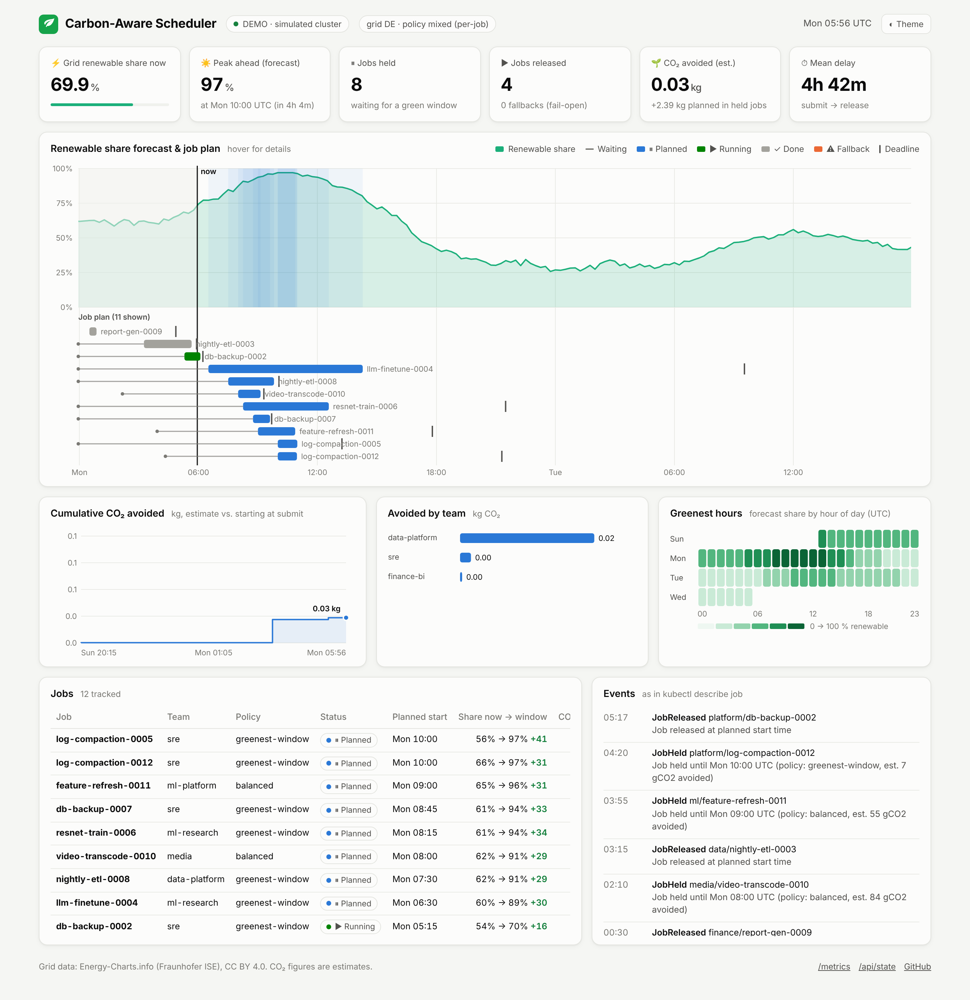</td>
    <td width="50%">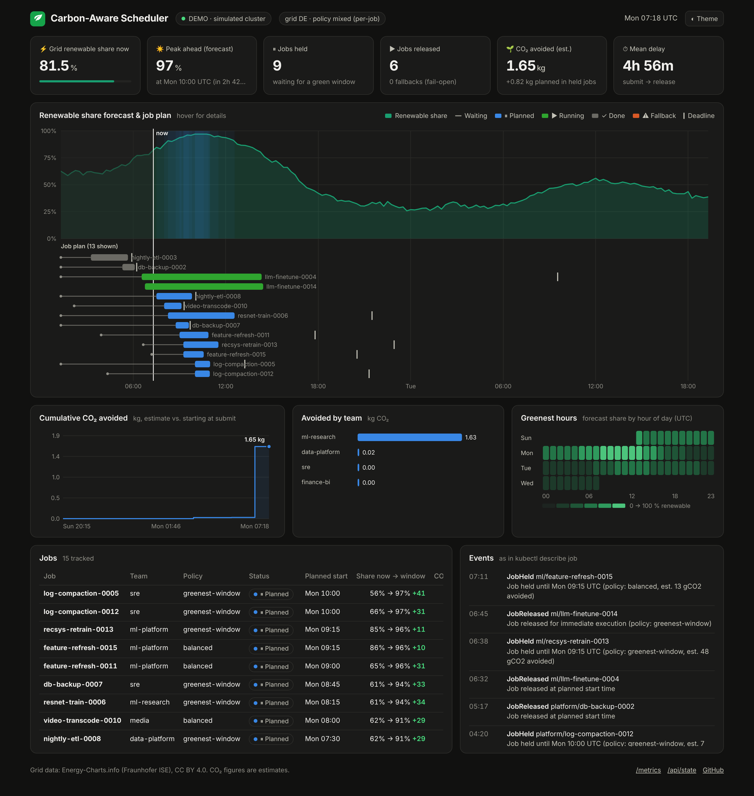</td>
  </tr>
  <tr>
    <td align="center"><sub>Dashboard, light theme</sub></td>
    <td align="center"><sub>Dashboard, dark theme</sub></td>
  </tr>
</table>

<table>
  <tr>
    <td width="66%" valign="top">
      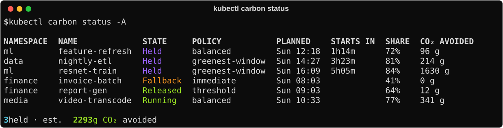<br>
      <sub><code>kubectl carbon status -A</code>: every flexible Job, its plan and its saving</sub><br><br>
      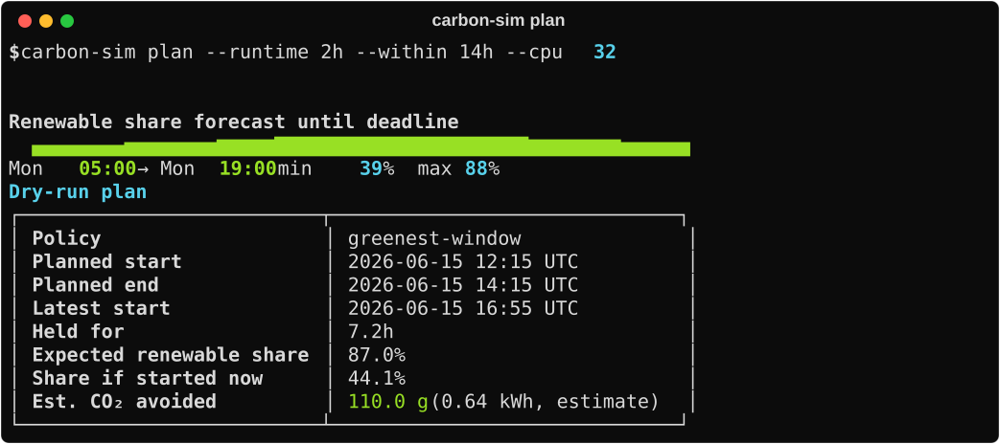<br>
      <sub><code>carbon-sim plan</code>: dry-run a Job against the forecast before submitting it</sub>
    </td>
    <td width="34%" valign="top" align="center">
      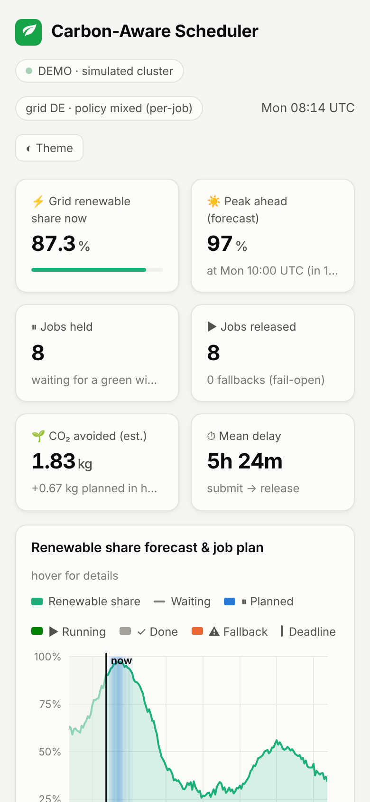<br>
      <sub>Responsive down to phone width</sub>
    </td>
  </tr>
</table>

<details>
<summary><b>carbon-sim showcase</b> terminal output</summary>
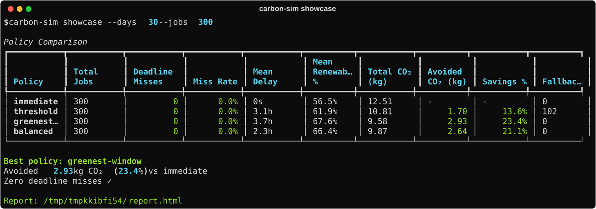
</details>

## 🚀 Quick start on Kubernetes

**One command** (needs Docker, `kind`, `kubectl`, Helm 3): builds the image, creates a kind cluster, installs the chart, submits example Jobs and opens the dashboard on <http://localhost:9090>.

```bash
make kind-demo
```

Or install a published release (multi-arch image and chart on GHCR):

```bash
helm install carbon-scheduler oci://ghcr.io/mahmudul-islam32/charts/carbon-scheduler --version <version>
```

Or step by step:

```bash
kind create cluster --name carbon
docker build -t carbon-scheduler:dev .
kind load docker-image carbon-scheduler:dev --name carbon
helm install carbon-scheduler ./charts/carbon-scheduler \
  --set image.repository=carbon-scheduler --set image.tag=dev
kubectl port-forward svc/carbon-scheduler-metrics 9090   # dashboard on http://localhost:9090
```

Submit a flexible Job:

```yaml
apiVersion: batch/v1
kind: Job
metadata:
  name: nightly-etl
  labels:
    team: data-platform            # optional: groups CO₂ savings by team on the dashboard
  annotations:
    carbon-scheduler.mahmudul-islam32.github.io/flexible: "true"
    carbon-scheduler.mahmudul-islam32.github.io/deadline-in: "10h"     # or an absolute `deadline`
    carbon-scheduler.mahmudul-islam32.github.io/estimated-runtime: "2h"
spec:
  suspend: true   # submitted suspended; the controller releases it
  template:
    spec:
      restartPolicy: Never
      containers:
        - name: etl
          image: busybox:1.36
          command: ["sh", "-c", "echo running && sleep 60"]
          resources:
            requests:
              cpu: "4"
```

Then see what the controller decided:

```bash
kubectl carbon status            # plan, countdown, expected share, CO₂ avoided
kubectl carbon explain nightly-etl
kubectl describe job nightly-etl # Events: JobHeld / JobReplanned / JobReleased / FallbackRelease
```

`kubectl carbon` is installed with the package (`pip install -e .`). More manifests are in [`examples/`](examples/), including a [CronJob](examples/batch-processing-cronjob.yaml) and the [balanced policy](examples/balanced-policy.yaml).

## 🏷️ Job annotations

All keys use the prefix `carbon-scheduler.mahmudul-islam32.github.io/`.

| Key | Set by | Example | Meaning |
|---|:---:|---|---|
| `flexible` | you | `"true"` | Opt in |
| `deadline` | you | `"2026-11-02T06:00:00+01:00"` | Job must finish by this time (ISO 8601) |
| `deadline-in` | you | `"6h"` | Relative deadline from the Job's creation; use instead of `deadline` (CronJobs) |
| `estimated-runtime` | you | `"2h"`, `"1h30m"` | Used to size the window |
| `policy` | you, optional | `"balanced"` | Override the controller-wide policy |
| `renewable-threshold` | you, optional | `"70"` | Override the threshold for `threshold` |
| `delay-penalty` | you, optional | `"3"` | `balanced`: share points given up per hour of waiting |
| `max-delay` | you, optional | `"8h"` | Never hold longer than this after submit |
| `planned-start` | controller | ISO 8601 | When the Job will be released |
| `latest-start` | controller | ISO 8601 | Release no later than this (deadline or max-delay) |
| `planned-at` | controller | ISO 8601 | When the plan was made or last checked against a fresh forecast |
| `expected-renewable-share` | controller | `"79.5"` | Mean forecast share in the planned window |
| `co2-avoided-grams` | controller | `"22.10"` | Estimated CO₂ avoided vs starting now |
| `policy-used`, `fallback-reason`, `actual-start` | controller | | Audit trail |

## 🧮 Policies

| Policy | Picks | Good for |
|---|---|---|
| `immediate` | Now | Baseline |
| `threshold` | First slot with forecast share ≥ X % | Simple, predictable rules |
| `greenest-window` | The runtime-sized window with the highest mean share | Maximum savings |
| `balanced` | Highest *mean share − delay × penalty* | Most of the saving with much less waiting |

<p align="center">
  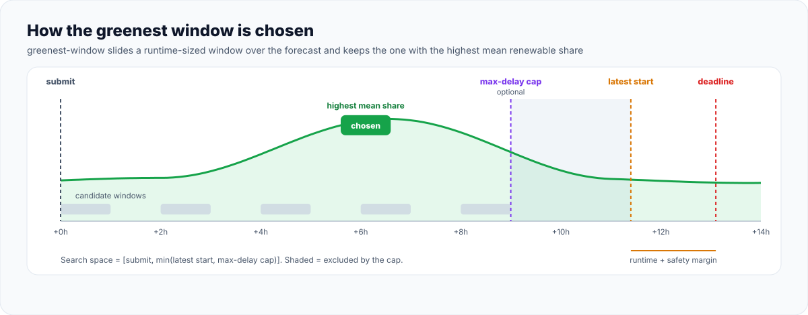
</p>

## 🏗️ Architecture

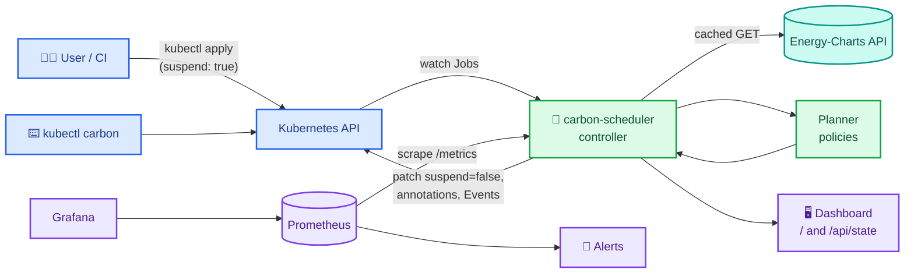

More detail is in [docs/ARCHITECTURE.md](docs/ARCHITECTURE.md).

## ⚙️ Configuration

Environment variables (Helm: `config.*` in [`values.yaml`](charts/carbon-scheduler/values.yaml)).

| Variable | Default | Description |
|---|---|---|
| `CARBON_POLICY` | `greenest-window` | `immediate`, `threshold`, `greenest-window` or `balanced` |
| `CARBON_RENEWABLE_THRESHOLD_PCT` | `60` | Threshold policy: release when the forecast share is at or above this value |
| `CARBON_DELAY_PENALTY_PCT_PER_HOUR` | `2` | Balanced policy: share points subtracted per hour of delay |
| `CARBON_MAX_DELAY` | `24h` | Longest a Job may be held after submission (`""` disables) |
| `CARBON_MAX_RELEASES_PER_MINUTE` | `0` | Release staggering (`0` disables); deadline-critical releases always pass |
| `CARBON_REPLAN_ENABLED` | `true` | Re-plan held Jobs when a newer forecast is fetched |
| `CARBON_REPLAN_MIN_IMPROVEMENT_PCT` | `3` | Hysteresis: move a plan only if the new window is greener by more than this many points |
| `CARBON_DEADLINE_SAFETY_MARGIN_MINUTES` | `5` | Buffer before the deadline |
| `CARBON_GRID_COUNTRY` | `de` | Energy-Charts country code |
| `CARBON_FORECAST_REFRESH_MINUTES` | `30` | Forecast cache TTL |
| `CARBON_RECONCILE_INTERVAL_SECONDS` | `60` | Release timer interval |
| `CARBON_FOSSIL_INTENSITY_GCO2_KWH` | `400` | Intensity of the non-renewable share (CO₂ estimate) |
| `CARBON_WATTS_PER_CPU_CORE` / `CARBON_WATTS_PER_GPU` | `10` / `200` | Job power model (CO₂ estimate) |
| `CARBON_EMISSION_FACTORS_FILE` | `config/emission_factors.yaml` | gCO₂/kWh per production type |
| `CARBON_METRICS_PORT` | `9090` | `/`, `/api/state`, `/metrics`, `/healthz`, `/readyz` |
| `CARBON_DASHBOARD_ENABLED` | `true` | Serve the web dashboard on the metrics port |
| `CARBON_LOG_LEVEL` / `CARBON_LOG_FORMAT` | `INFO` / `json` | Logging |

Alerts: `--set alerts.enabled=true` installs a [PrometheusRule](charts/carbon-scheduler/templates/prometheusrule.yaml) with five alerts. Runbooks are in [FEATURES.md](docs/FEATURES.md#f-32--prometheusrule-alert-pack).

## 🧰 CLI reference

| Command | What it does |
|---|---|
| `carbon-sim dashboard [--start ISO] [--live-forecast]` | Dashboard on a simulated cluster |
| `carbon-sim showcase` | Synthetic data → trace → backtest → HTML report, offline |
| `carbon-sim plan --runtime 2h --within 12h` | Dry-run one Job against the live forecast |
| `carbon-sim mock-api [--green-after 90]` | Deterministic mock of the Energy-Charts API (used by the kind E2E test) |
| `carbon-sim fetch` / `synth` | Real Energy-Charts history, or synthetic history |
| `carbon-sim generate-trace` / `backtest` / `summary` / `report` | Build a job trace, compare policies, print or render results |
| `kubectl carbon status \| explain \| release \| forecast` | Inspect and steer Jobs in the cluster |

## 🛠️ Development

```bash
make install     # pip install -e ".[dev]"
make check       # ruff + mypy --strict + pytest (394 tests)
make e2e         # end-to-end on a throwaway kind cluster (Docker, kind, kubectl, Helm)
make demo        # dashboard on a simulated cluster
make media       # regenerate the screenshots, GIF and video in docs/media
```

CI runs the same checks plus a version-sync check, `helm lint`, `helm template` (with alerts, ServiceMonitor and Grafana enabled) and a Docker build on every pull request. An **end-to-end job on kind** then installs the chart against a mock Energy-Charts API (`carbon-sim mock-api`) and asserts that a flexible Job is held (`planned-start`, `JobHeld` Event) and then released (`JobReleased`).

### Releasing

`carbon_scheduler.__version__` is the single source of the version; `pyproject.toml` reads it and
`Chart.yaml` is kept equal to it.

```bash
python -m carbon_scheduler.release bump 0.2.0   # updates __init__.py and Chart.yaml
python -m carbon_scheduler.release check        # fails on drift (also runs in CI)
# merge the bump, then:
git tag v0.2.0 && git push origin v0.2.0
```

The tag runs [`release.yml`](.github/workflows/release.yml): it pushes `ghcr.io/mahmudul-islam32/carbon-scheduler:0.2.0`
(`linux/amd64`, `linux/arm64`), pushes the chart to `oci://ghcr.io/mahmudul-islam32/charts`, and creates a
GitHub Release with notes generated from Conventional Commits.

## Data attribution

Grid data comes from **Energy-Charts.info** (Fraunhofer ISE), licensed under CC BY 4.0. The API does not publish a carbon-intensity series. All CO₂ figures in this project are *estimates* derived from the published renewable share or generation mix and documented emission factors. Demo and showcase numbers use synthetic grid data.

## Contributing

Pick an item from the [roadmap](docs/FEATURES.md#backlog). Each has acceptance criteria you can turn into tests. Conventions: feature branches named after the feature ID (`feat/F-20-replan`), Conventional Commits, and green CI.

## License

Released under the [MIT License](LICENSE). Copyright (c) 2026 Mahmudul Islam.

## Author

**Mahmudul Islam** · M.Sc. Computer Science · [github.com/mahmudul-islam32](https://github.com/mahmudul-islam32)
