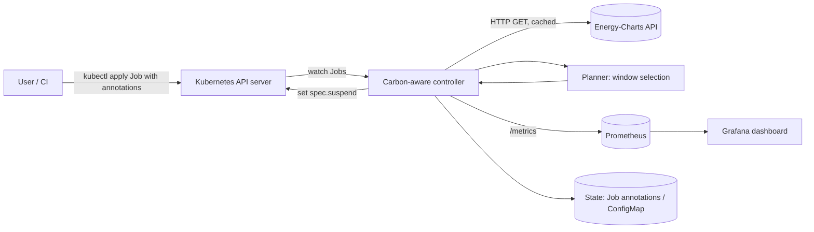

# Carbon-Aware Kubernetes Batch Scheduler


A Kubernetes controller, planned in Python, that holds back flexible batch workloads such as ML training and ETL and releases them when the German electricity grid is greenest. It reads the renewable share of load and the generation mix from the public [Energy-Charts API](https://api.energy-charts.info/) run by Fraunhofer ISE, picks a start window within each job's deadline, and records how much CO₂ was avoided compared with starting the job right away. A Grafana dashboard shows the result.

> **Status: planning and design phase.** This repository holds the docs only: requirements, features and architecture. Nothing is implemented yet. Every feature below is **planned**.

## Motivation

Data centres use a growing share of electricity, and the carbon intensity of the German grid swings widely over a day as solar and wind output changes. Many batch jobs, like nightly ETL, model training or report generation, have slack: they need to finish *by* a deadline, not start *now*. Moving them in time is a cheap way to cut emissions without new hardware. This project aims to measure how much a simple, transparent scheduler can save on real German grid data.

## Key Features (planned)

- **Opt-in by annotation.** Mark a `batch/v1` Job as flexible and give it a deadline and an estimated runtime.
- **Suspend and release.** Uses the native Job field `spec.suspend` to hold Jobs and resumes them at the chosen time. No custom scheduler binary is needed.
- **Grid signal ingestion.** Polls Energy-Charts `/ren_share_forecast`, `/signal` and `/public_power` for Germany (`country=de`), with caching that respects the API rate limits.
- **Window selection.** Picks the greenest feasible window within the deadline, and falls back to an immediate start if the data is missing.
- **CO₂ accounting.** Estimates emissions for the actual start and for a counterfactual "start at submit time", using generation-mix emission factors.
- **Prometheus metrics and Grafana dashboard.** Shows queued jobs, delay, estimated gCO₂ avoided and the forecast vs actual renewable share.
- **Optional KEDA mode.** An alternative design that uses KEDA `ScaledJob` with a metrics-API trigger.
- **Simulation and backtest CLI.** Replays historical grid data against a job trace to compare policies offline.

See [docs/FEATURES.md](docs/FEATURES.md) for IDs, user stories and acceptance criteria.

## Architecture Overview



More detail is in [docs/ARCHITECTURE.md](docs/ARCHITECTURE.md).

## Tech Stack (planned)

| Area | Choice |
|---|---|
| Language | Python 3.12+ |
| Controller framework | [kopf](https://github.com/nolar/kopf) (Kubernetes Operator Pythonic Framework) with the official `kubernetes` client |
| Alternative mode | [KEDA](https://keda.sh/) `ScaledJob` (Metrics API scaler) |
| Grid data | Fraunhofer ISE Energy-Charts API (CC BY 4.0, attribution required) |
| Metrics | `prometheus_client`, Prometheus |
| Dashboard | Grafana (provisioned JSON dashboard) |
| Local cluster | kind or k3d |
| Packaging | Docker image and Helm chart |
| Quality | pytest, ruff, mypy, GitHub Actions |

## Project Status

📐 **Planning and design.** Requirements and architecture are being written. No code, image or chart has been released.

## Roadmap

| Milestone | Scope | Target |
|---|---|---|
| M0: Design | This documentation, the API study and the emission-factor table | Week 0 |
| M1: Grid client | Energy-Charts client, caching, rate-limit handling, unit tests | Week 1 |
| M2: Controller MVP | Annotation contract, suspend and release of Jobs, deadline fallback | Week 2 |
| M3: Accounting and observability | CO₂ estimator, Prometheus metrics, Grafana dashboard | Week 3 |
| M4: Evaluation | Backtest CLI, policy comparison report, Helm chart, KEDA mode (stretch) | Week 4 |

Level: intermediate. Estimated effort: 3 to 4 weeks.

## Getting Started (planned)

Prerequisites:
- Docker, plus `kind` or `k3d`
- `kubectl` and Helm 3
- Python 3.12+ (for development)
- Internet access to `api.energy-charts.info`

Planned flow:
```bash
# planned, not yet available
kind create cluster --name carbon
helm install carbon-scheduler ./charts/carbon-scheduler
kubectl apply -f examples/etl-job.yaml   # a Job annotated as flexible
```

Planned Job annotations (draft contract):
```yaml
metadata:
  annotations:
    carbon-scheduler.mahmudul-islam32.github.io/flexible: "true"
    carbon-scheduler.mahmudul-islam32.github.io/deadline: "2026-11-02T06:00:00+01:00"
    carbon-scheduler.mahmudul-islam32.github.io/estimated-runtime: "2h"
spec:
  suspend: true   # submitted suspended; the controller releases it
```

## Configuration Overview (planned)

| Key | Default | Description |
|---|---|---|
| `GRID_COUNTRY` | `de` | Energy-Charts country code |
| `POLICY` | `greenest-window` | `immediate`, `threshold` or `greenest-window` |
| `RENEWABLE_THRESHOLD_PCT` | `60` | Threshold policy: release when the forecast share is at or above this value |
| `FORECAST_REFRESH_MINUTES` | `30` | Polling interval (the API defaults to about 2 requests per minute per endpoint) |
| `MAX_DELAY` | `24h` | Hard cap on how long a Job can be held, on top of its deadline |
| `EMISSION_FACTORS_FILE` | `config/emission_factors.yaml` | gCO₂/kWh per production type |
| `METRICS_PORT` | `9090` | Prometheus scrape port |

## Data Attribution

Grid data comes from **Energy-Charts.info** (Fraunhofer ISE), licensed under CC BY 4.0. The API does not publish a carbon-intensity series. CO₂ figures in this project will be *estimates* derived from the published generation mix and documented emission factors.

## Contributing

The project is in the design phase, so the most useful contributions right now are feedback on the docs. Open an issue to discuss a requirement, design decision or feature before you send a pull request. Planned conventions: feature branches, Conventional Commits, `ruff` + `pytest` in CI.

## License

Released under the [MIT License](LICENSE). Copyright (c) 2026 Mahmudul Islam.

## Author

**Mahmudul Islam** · M.Sc. Computer Science · [github.com/mahmudul-islam32](https://github.com/mahmudul-islam32)
