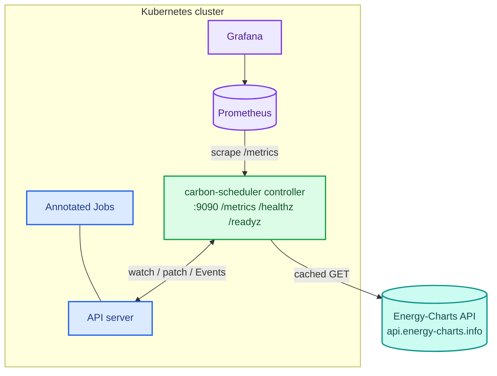
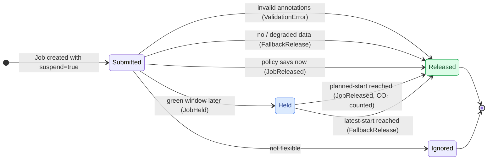
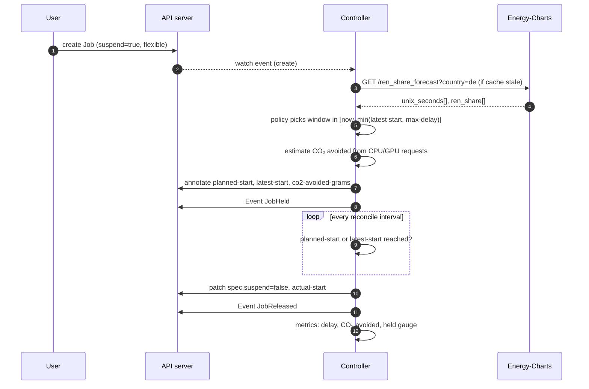

# Architecture: carbon-aware-k8s-scheduler

> Status: **alpha, implemented.** Feature status and roadmap: [FEATURES.md](FEATURES.md).

## 1. Goals and non-goals
**Goals:** shift flexible Kubernetes Jobs in time to reduce estimated CO₂, never break deadlines, and stay transparent and observable.
**Non-goals (for now):** spatial shifting across regions ([F-24](FEATURES.md#f-24--spatial-multi-region-shifting)), node-level power measurement ([F-31](FEATURES.md#f-31--measured-energy-via-kepler)), replacing kube-scheduler.

## 2. Context

## 3. Components

| Package | Responsibility | Key features |
|---|---|---|
| [`grid`](../src/carbon_scheduler/grid) | Energy-Charts client for `/ren_share_forecast`, `/signal`, `/public_power`. Caching, `Retry-After` handling, `substitute` flag propagation, request metrics | F-03, F-19 |
| [`planner`](../src/carbon_scheduler/planner) | Pure policy functions: `immediate`, `threshold`, `greenest-window` | F-04 |
| [`carbon`](../src/carbon_scheduler/carbon) | Intensity from generation mix and emission factors; live per-job estimate from renewable share and resource requests | F-06, F-16 |
| [`controller`](../src/carbon_scheduler/controller) | kopf handlers for Job create/update, release timer, annotation contract, Event posting | F-01, F-02, F-05, F-12, F-14, F-15 |
| [`metrics`](../src/carbon_scheduler/metrics) | Prometheus metrics plus the HTTP server for `/metrics`, `/healthz`, `/readyz` | F-07, F-13, F-19 |
| [`sim`](../src/carbon_scheduler/sim) | `carbon-sim` CLI: fetch history, generate traces, backtest, dry-run plan | F-09, F-17 |

## 4. Job lifecycle

## 5. Release sequence

## 6. Data and units
- Energy-Charts v1 responses use `unix_seconds` arrays aligned with value arrays. The client targets v1.
- Renewable share is in %. Production is in MW per production type.
- Grid carbon intensity (gCO₂/kWh) = Σ(Pᵢ · EFᵢ) / Σ Pᵢ over production types, with EFᵢ from the versioned [`emission_factors.yaml`](../config/emission_factors.yaml). Imports and exports are ignored (documented limitation).
- The live per-job estimate (F-16) uses the renewable-share proxy `intensity = fossil_intensity × (1 − share/100)`, because only the forecast is available at planning time. The backtest uses the same proxy, so live and offline numbers are comparable.

## 7. Reliability and security
- **Fail-open:** when data is missing or degraded, Jobs run as they would without the scheduler.
- **Stateless:** all state lives in Job annotations (`planned-start`, `latest-start`, …). The release timer also rebuilds the held-jobs gauge after a restart.
- **Probes:** `/healthz` (process alive) and `/readyz` (grid client initialised) on the metrics port.
- **RBAC** is least-privilege: Jobs get/list/watch/patch, Events create/patch. No secrets are needed, because the public API is unauthenticated.
- **Rate limits:** one shared cache per controller respects the API's published limits (about 2 requests per minute per endpoint).
- **Single replica** today. HA with leader election is [F-27](FEATURES.md#f-27--high-availability-with-leader-election).

## 8. Evaluation plan
Backtest policies over at least 3 months of historical German data with synthetic job traces of varied slack. Report avoided CO₂ (estimate), mean and p95 delay, and deadline misses (target: 0).

## 9. Decisions and open questions

| Question | Decision |
|---|---|
| v1 or v2 Energy-Charts endpoints? | v1 for the MVP |
| Emission-factor source | IPCC AR5 lifecycle medians, cross-checked with UBA (see YAML) |
| Should a mutating webhook set `suspend: true`? | Yes, planned as [F-21](FEATURES.md#f-21--mutating-admission-webhook) |
| How do CronJobs express deadlines? | Open; relative deadlines planned as [F-22](FEATURES.md#f-22--relative-deadlines-for-cronjobs) |
| Should plans move when the forecast changes? | Open; planned as [F-20](FEATURES.md#f-20--re-plan-on-forecast-refresh) |
