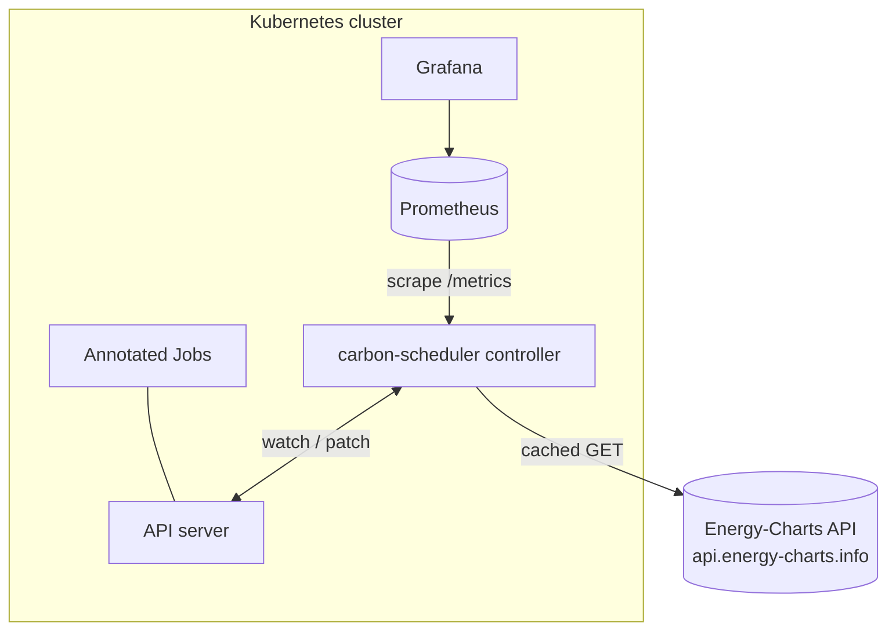
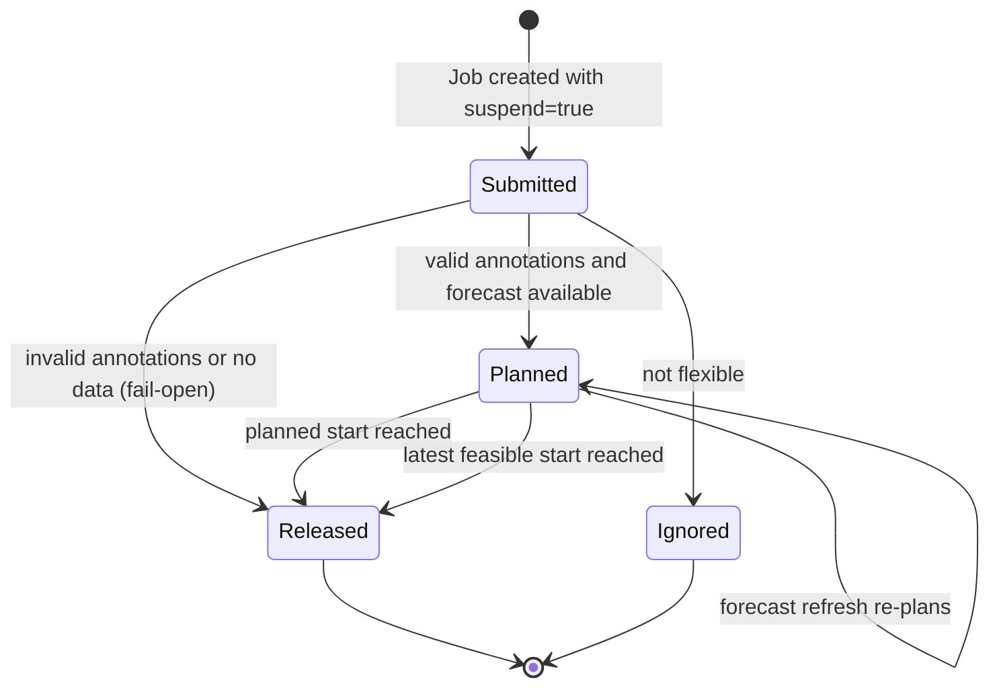
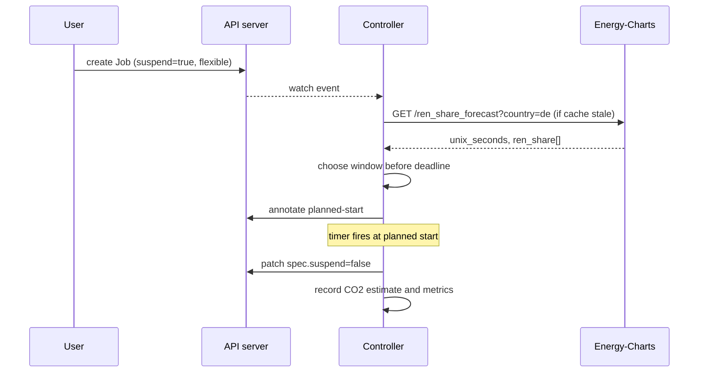

# Architecture: carbon-aware-k8s-scheduler

> Design document. Status: **draft, planned**. Nothing described here is implemented yet.

## 1. Goals and non-goals
**Goals:** shift flexible Kubernetes Jobs in time to reduce estimated CO₂, never break deadlines, and stay transparent and observable.
**Non-goals:** spatial shifting across regions (future work), node-level power measurement, replacing kube-scheduler.

## 2. Context

## 3. Components (planned)
| Component | Responsibility |
|---|---|
| `grid` | Energy-Charts client. Endpoints `/ren_share_forecast`, `/signal`, `/public_power` (`country=de`). Caching, `Retry-After` handling, `substitute` flag propagation |
| `planner` | Pure policy functions: `immediate`, `threshold`, `greenest-window` |
| `carbon` | Intensity estimation from generation mix and emission factors, plus a job energy model |
| `controller` | kopf handlers for Job create and update, timers for release, Event emission |
| `metrics` | Prometheus exporters |
| `sim` | Offline backtest over stored historical data |

## 4. Job lifecycle

## 5. Release sequence

## 6. Data and units
- Energy-Charts v1 responses use `unix_seconds` arrays aligned with value arrays. The v2 endpoints (`/v2/...`) return a self-describing envelope with ISO 8601 timestamps. The client will target one version behind an interface.
- Renewable share is in %. Production is in MW per production type.
- Carbon intensity (gCO₂/kWh) = Σ(Pᵢ · EFᵢ) / Σ Pᵢ over the production types. EFᵢ comes from a cited, versioned config file. This is an estimate; imports and exports are ignored in v1 (documented limitation).

## 7. Reliability and security
- Fail-open: when data is missing, Jobs run as they would without the scheduler.
- State lives only in Job annotations, so the controller is stateless and restart-safe. Leader election is used when replicas > 1.
- RBAC is least-privilege. No secrets are needed, because the public API is unauthenticated.
- Respect for the API's published limits (about 2 requests per minute per endpoint by default): one shared cache per controller.

## 8. Evaluation plan
Backtest policies over at least 3 months of historical German data with synthetic job traces of varied slack. Report avoided CO₂ (estimate), mean and p95 delay, and deadline misses (target: 0).

## 9. Open questions
- Use the v1 or v2 Energy-Charts endpoints for the MVP?
- Which emission-factor source (e.g. IPCC lifecycle medians vs UBA national factors)?
- Should a mutating webhook set `suspend: true` automatically?
