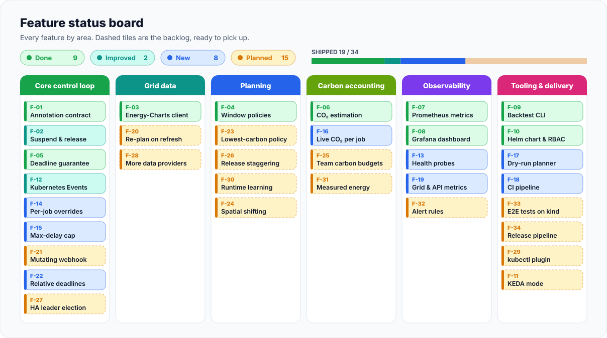
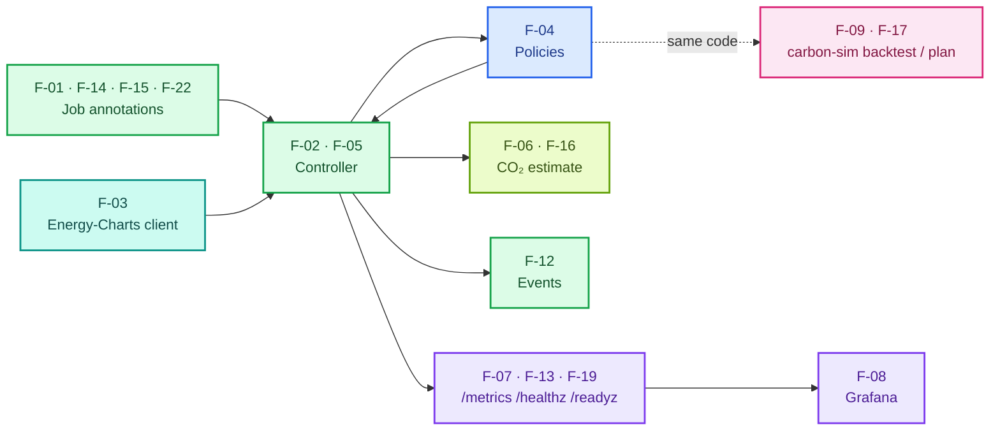
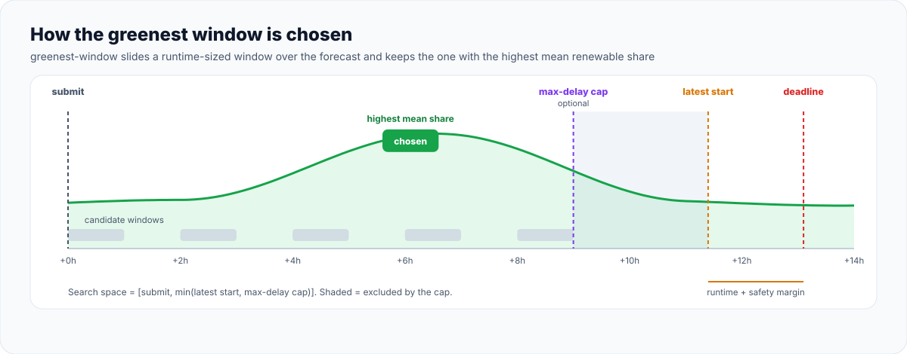
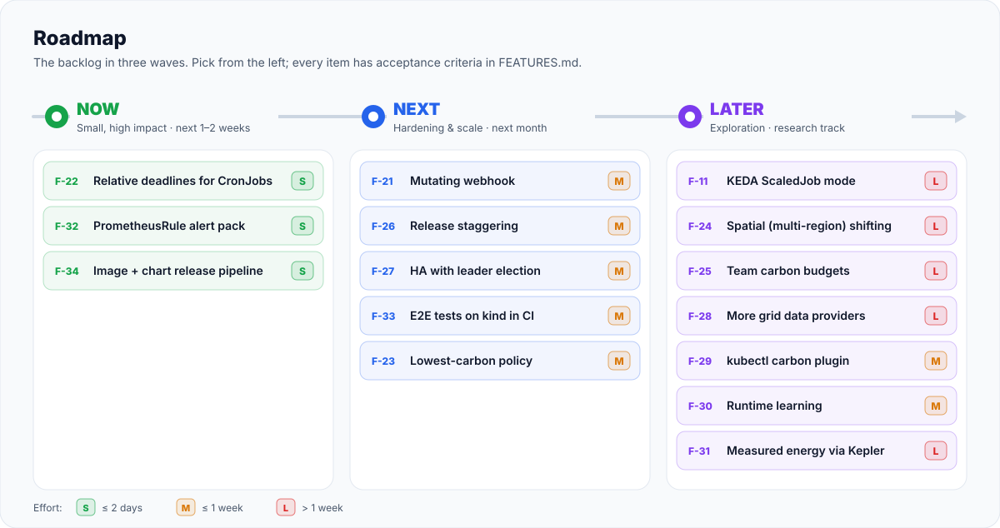
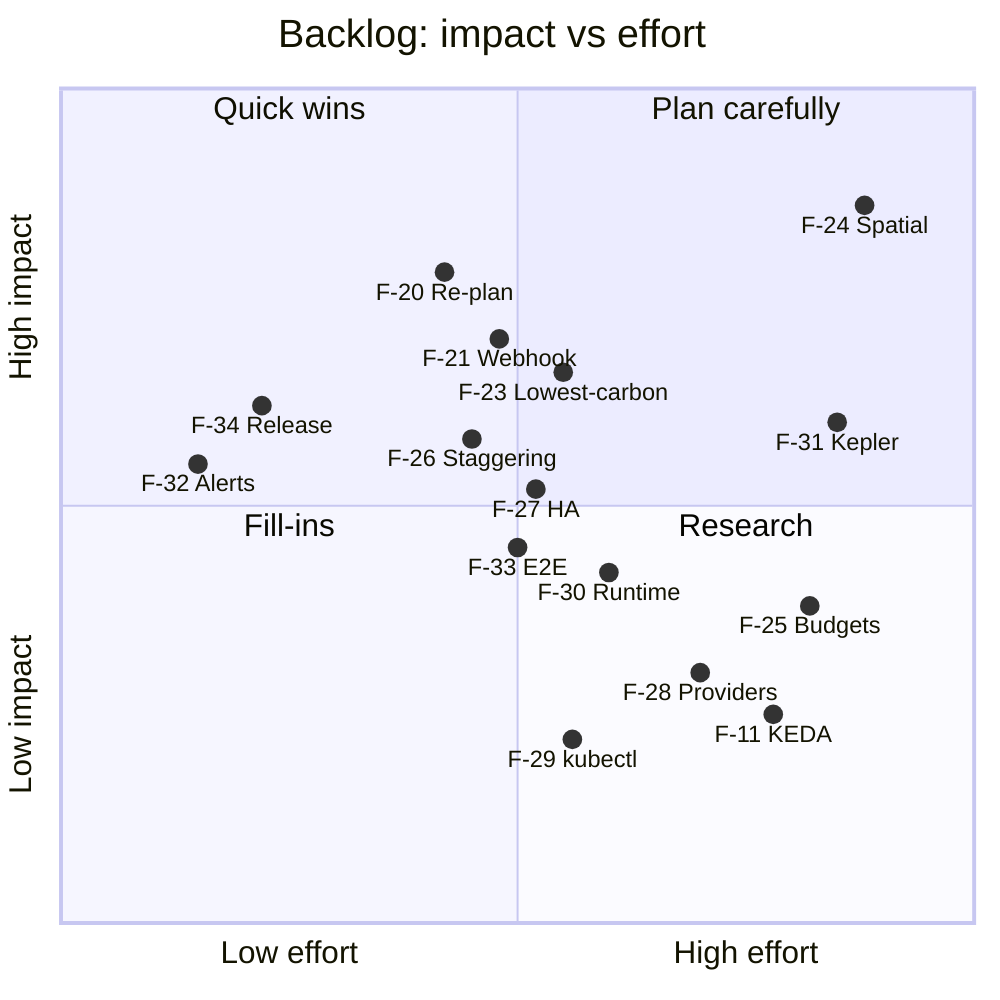
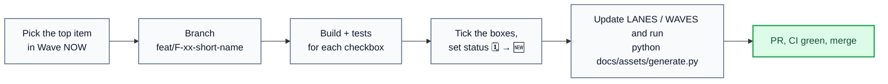

# Feature Catalogue

<p align="center">
  
</p>

<p align="center">
  
  
  
  
</p>

This is the single source of truth for what the scheduler does today and what comes next.
Every feature has an ID, a user story and acceptance criteria written as checkboxes, so you
can pick one, build it, tick the boxes and flip its status.

**Contents**

1. [Legend](#legend)
2. [At a glance](#at-a-glance)
3. [How the pieces fit](#how-the-pieces-fit)
4. [Shipped features](#shipped-features) (F-01 to F-19, F-22)
5. [Backlog](#backlog) (F-11, F-20, F-21, F-23 to F-34)
6. [Working through the backlog](#working-through-the-backlog)

---

## Legend

| Badge | Meaning |
|:---:|---|
| ✅ **Done** | Implemented and covered by tests |
| 🔁 **Improved** | Existed before, reworked or fixed in the latest iteration |
| 🆕 **New** | Added in the latest iteration |
| 🗓️ **Planned** | In the backlog, with acceptance criteria ready |

**Priority** uses MoSCoW (`Must`, `Should`, `Could`). **Effort**: `S` ≤ 2 days, `M` ≤ 1 week, `L` > 1 week.
**Impact**: how much the feature moves CO₂ savings, reliability or adoption.

---

## At a glance

| ID | Feature | Area | Priority | Status |
|---|---|---|:---:|:---:|
| [F-01](#f-01--flexible-job-annotation-contract) | Flexible-job annotation contract | Core control loop | Must | ✅ Done |
| [F-02](#f-02--suspend-and-release-controller) | Suspend and release controller | Core control loop | Must | 🔁 Improved |
| [F-03](#f-03--energy-charts-grid-client) | Energy-Charts grid client | Grid data | Must | ✅ Done |
| [F-04](#f-04--window-selection-policies) | Window-selection policies | Planning | Must | ✅ Done |
| [F-05](#f-05--deadline-guarantee-and-fail-open-fallback) | Deadline guarantee and fail-open fallback | Core control loop | Must | ✅ Done |
| [F-06](#f-06--co2-estimation-and-counterfactual) | CO₂ estimation and counterfactual | Carbon accounting | Must | ✅ Done |
| [F-07](#f-07--prometheus-metrics) | Prometheus metrics | Observability | Must | ✅ Done |
| [F-08](#f-08--grafana-dashboard) | Grafana dashboard | Observability | Should | ✅ Done |
| [F-09](#f-09--backtest-and-simulation-cli) | Backtest and simulation CLI | Tooling | Should | ✅ Done |
| [F-10](#f-10--helm-chart-and-rbac) | Helm chart and RBAC | Tooling | Should | ✅ Done |
| [F-12](#f-12--kubernetes-events-and-audit-trail) | Kubernetes Events and audit trail | Core control loop | Could | 🔁 Improved |
| [F-13](#f-13--health-and-readiness-probes) | Health and readiness probes | Observability | Must | 🆕 New |
| [F-14](#f-14--per-job-policy-overrides) | Per-job policy overrides | Core control loop | Should | 🆕 New |
| [F-15](#f-15--max-delay-cap) | Max-delay cap | Core control loop | Should | 🆕 New |
| [F-16](#f-16--live-co2-estimate-per-job) | Live CO₂ estimate per job | Carbon accounting | Should | 🆕 New |
| [F-17](#f-17--dry-run-planner-carbon-sim-plan) | Dry-run planner (`carbon-sim plan`) | Tooling | Should | 🆕 New |
| [F-18](#f-18--ci-pipeline) | CI pipeline | Tooling | Should | 🆕 New |
| [F-19](#f-19--grid-and-api-observability) | Grid and API observability | Observability | Should | 🆕 New |
| [F-20](#f-20--re-plan-on-forecast-refresh) | Re-plan on forecast refresh | Grid data | Should | 🗓️ Planned |
| [F-21](#f-21--mutating-admission-webhook) | Mutating admission webhook | Core control loop | Should | 🗓️ Planned |
| [F-22](#f-22--relative-deadlines-for-cronjobs) | Relative deadlines for CronJobs | Core control loop | Should | 🆕 New |
| [F-23](#f-23--lowest-carbon-policy) | Lowest-carbon policy | Planning | Could | 🗓️ Planned |
| [F-24](#f-24--spatial-multi-region-shifting) | Spatial (multi-region) shifting | Planning | Could | 🗓️ Planned |
| [F-25](#f-25--team-carbon-budgets) | Team carbon budgets | Carbon accounting | Could | 🗓️ Planned |
| [F-26](#f-26--release-staggering) | Release staggering | Planning | Should | 🗓️ Planned |
| [F-27](#f-27--high-availability-with-leader-election) | High availability with leader election | Core control loop | Should | 🗓️ Planned |
| [F-28](#f-28--more-grid-data-providers) | More grid data providers | Grid data | Could | 🗓️ Planned |
| [F-29](#f-29--kubectl-carbon-plugin) | `kubectl carbon` plugin | Tooling | Could | 🗓️ Planned |
| [F-30](#f-30--runtime-learning) | Runtime learning | Planning | Could | 🗓️ Planned |
| [F-31](#f-31--measured-energy-via-kepler) | Measured energy via Kepler | Carbon accounting | Could | 🗓️ Planned |
| [F-32](#f-32--prometheusrule-alert-pack) | PrometheusRule alert pack | Observability | Should | 🗓️ Planned |
| [F-33](#f-33--end-to-end-tests-on-kind) | End-to-end tests on kind | Tooling | Should | 🗓️ Planned |
| [F-34](#f-34--release-pipeline) | Release pipeline | Tooling | Should | 🗓️ Planned |
| [F-11](#f-11--keda-scaledjob-mode) | KEDA ScaledJob mode | Tooling | Could | 🗓️ Planned |

---

## How the pieces fit

<p align="center">
  
</p>



<p align="center">
  
</p>

---

## Shipped features

### F-01 · Flexible-job annotation contract

`✅ Done` · `Must` · `Core control loop` · [`controller/annotations.py`](../src/carbon_scheduler/controller/annotations.py)

> **As a** data engineer, **I want** to mark my nightly ETL Job as flexible with a few annotations, **so that** I don't need to learn a new CRD.

| Annotation (prefix `carbon-scheduler.mahmudul-islam32.github.io/`) | Required | Example |
|---|:---:|---|
| `flexible` | ✔ | `"true"` |
| `deadline` or `deadline-in` | ✔ (one of) | `"2026-11-02T06:00:00+01:00"` or `"6h"` (see [F-22](#f-22--relative-deadlines-for-cronjobs)) |
| `estimated-runtime` | ✔ | `"2h"`, `"1h30m"`, `"90m"` |
| `policy`, `renewable-threshold`, `max-delay` | | see [F-14](#f-14--per-job-policy-overrides) and [F-15](#f-15--max-delay-cap) |

**Acceptance criteria**
- [x] Jobs without `flexible: "true"` are ignored.
- [x] Invalid deadline or runtime values cause a Warning Event, and the Job is released right away (fail-open).
- [x] The contract is documented with examples (`examples/`).

---

### F-02 · Suspend and release controller

`🔁 Improved` · `Must` · `Core control loop` · [`controller/handlers.py`](../src/carbon_scheduler/controller/handlers.py)

> **As a** platform engineer, **I want** delayed Jobs to use native Kubernetes behaviour, **so that** existing tooling keeps working.

**What changed in this iteration:** the controller now opens the Energy-Charts HTTP session at startup.
Before, every grid fetch failed with "client not initialized", so in a real cluster every Job was
fallback-released. Every release now also writes `actual-start`, and the release timer interval follows
`CARBON_RECONCILE_INTERVAL_SECONDS`.

**Acceptance criteria**
- [x] The planned start time is written to an annotation (`.../planned-start`).
- [x] The Job is released within 60 s of the planned start (default timer interval).
- [x] A controller restart does not lose or double-release Jobs, because state is rebuilt from annotations.
- [x] The grid client session is opened on startup and closed on shutdown.

---

### F-03 · Energy-Charts grid client

`✅ Done` · `Must` · `Grid data` · [`grid/client.py`](../src/carbon_scheduler/grid/client.py)

> **As** the controller, **I need** an up-to-date renewable-share forecast without exceeding the public rate limits.

**Acceptance criteria**
- [x] Handles HTTP 429 by honouring `Retry-After`.
- [x] Caches responses, refreshing every 30 minutes by default (`CARBON_FORECAST_REFRESH_MINUTES`).
- [x] Flags the data as degraded when the response has `substitute: true`.
- [x] Unit tests use mocked responses, not live calls.

---

### F-04 · Window-selection policies

`✅ Done` · `Must` · `Planning` · [`planner/policies.py`](../src/carbon_scheduler/planner/policies.py)

> **As a** researcher, **I want** to compare policies on the same input, **so that** I can quantify the benefit of each.

| Policy | Picks | Good for |
|---|---|---|
| `immediate` | Now | Baseline for comparisons |
| `threshold` | First slot with share ≥ X % | Simple, predictable rules |
| `greenest-window` | Runtime-sized window with the highest mean share | Maximum savings |

**Acceptance criteria**
- [x] Policies are pure functions of the forecast, the job and the current time, with unit tests.
- [x] The chosen window never ends after the deadline minus the safety margin.
- [x] A per-job threshold override no longer mutates the shared policy config (fixed in this iteration).

---

### F-05 · Deadline guarantee and fail-open fallback

`✅ Done` · `Must` · `Core control loop` · [`controller/scheduler.py`](../src/carbon_scheduler/controller/scheduler.py)

> **As a** job owner, **I want** my job to finish on time even when the forecast service is down.

**Acceptance criteria**
- [x] In simulated API outage tests, no Job misses its deadline because of the scheduler.
- [x] A fallback release increments `fallback_releases_total`.
- [x] Held Jobs are released at the latest feasible start, also after a restart (via `latest-start`).

---

### F-06 · CO2 estimation and counterfactual

`✅ Done` · `Must` · `Carbon accounting` · [`carbon/`](../src/carbon_scheduler/carbon)

> **As a** sustainability lead, **I want** to see estimated kg CO₂ avoided per job, **so that** I can report savings.

Carbon intensity (gCO₂/kWh) = Σ(Pᵢ · EFᵢ) / Σ Pᵢ over production types, using
[`config/emission_factors.yaml`](../config/emission_factors.yaml). Avoided CO₂ = emissions(start at submit) − emissions(actual start).

**Acceptance criteria**
- [x] Emission factors and their sources live in a versioned YAML file.
- [x] Each output is clearly labelled an estimate.
- [x] The calculation is unit-tested with hand-computed examples.

---

### F-07 · Prometheus metrics

`✅ Done` · `Must` · `Observability` · [`metrics/prometheus.py`](../src/carbon_scheduler/metrics/prometheus.py)

> **As an** SRE, **I want** standard metrics, **so that** I can alert on held Jobs and data outages.

| Metric | Type | Meaning |
|---|---|---|
| `carbon_jobs_held` | Gauge | Jobs waiting for a green window (rebuilt after restarts) |
| `carbon_job_delay_seconds` | Histogram | Submission → release delay |
| `carbon_co2_avoided_grams_total` | Counter | Estimated CO₂ avoided by on-plan releases |
| `carbon_grid_renewable_share_percent` | Gauge | Current forecast renewable share |
| `fallback_releases_total` | Counter | Fail-open releases |

**Acceptance criteria**
- [x] Metrics follow Prometheus naming conventions and are scrapeable at `/metrics`.
- [x] `carbon_jobs_held` cannot drift negative after a restart (held set rebuilt by the timer).

---

### F-08 · Grafana dashboard

`✅ Done` · `Should` · `Observability` · [`grafana/dashboard.json`](../grafana/dashboard.json)

> **As a** stakeholder, **I want** one screen that shows whether the scheduler is worth it.

**Acceptance criteria**
- [x] The dashboard JSON ships with the Helm chart (`grafana.enabled=true`) and loads without manual edits.
- [ ] Panels for the new F-19 metrics (forecast age, API latency, planned CO₂ histogram). *Good first issue.*

---

### F-09 · Backtest and simulation CLI

`✅ Done` · `Should` · `Tooling` · [`sim/`](../src/carbon_scheduler/sim)

> **As a** researcher, **I want** offline experiments that are reproducible and don't depend on live data.

```bash
carbon-sim fetch --start 2026-07-01 --end 2026-09-30 -o data/
carbon-sim generate-trace -n 500 --seed 42 -o trace.json
carbon-sim backtest --data data/ --trace trace.json --policies immediate,threshold,greenest-window -o results.csv
```

**Acceptance criteria**
- [x] Outputs a CSV and a summary table per policy (avoided CO₂, mean delay, deadline misses).
- [x] Deterministic for a fixed seed.

---

### F-10 · Helm chart and RBAC

`✅ Done` · `Should` · `Tooling` · [`charts/carbon-scheduler/`](../charts/carbon-scheduler)

> **As a** platform engineer, **I want** to install the scheduler with one command.

**Acceptance criteria**
- [x] Deployment, ServiceAccount, least-privilege RBAC (Jobs: get/list/watch/patch, Events: create/patch), optional ServiceMonitor and Grafana dashboard.
- [x] `helm lint` and `helm template` run in CI ([F-18](#f-18--ci-pipeline)).
- [ ] The chart installs on kind in CI → tracked by [F-33](#f-33--end-to-end-tests-on-kind).

---

### F-12 · Kubernetes Events and audit trail

`🔁 Improved` · `Could` · `Core control loop` · [`controller/handlers.py`](../src/carbon_scheduler/controller/handlers.py)

> **As a** job owner, **I want** `kubectl describe job` to explain why my job hasn't started.

**What changed in this iteration:** Events used to be written only to the controller log. They are
now posted to the Kubernetes API through kopf, so they show up in `kubectl describe job`.

| Reason | Type | When |
|---|---|---|
| `JobHeld` | Normal | Job planned for later; message includes planned start, policy and est. CO₂ avoided |
| `JobReleased` | Normal | Released on plan or immediately by policy |
| `FallbackRelease` | Warning | Released because of missing data or the deadline safety margin |
| `ValidationError` | Warning | Invalid annotations; Job released (fail-open) |

**Acceptance criteria**
- [x] Each state change produces exactly one Event with a reason code.
- [x] Events are visible in `kubectl describe job`.
- [x] Posting an Event can never block or fail a release.

---

### F-13 · Health and readiness probes

`🆕 New` · `Must` · `Observability` · [`metrics/prometheus.py`](../src/carbon_scheduler/metrics/prometheus.py)

> **As a** platform engineer, **I want** probes that reflect the controller's real state, **so that** Kubernetes restarts it when it is broken and does not mark it ready too early.

The Helm chart and the Docker `HEALTHCHECK` already probed `/healthz` and `/readyz` on the metrics
port, but nothing served them, so pods never became ready. The metrics server now serves both.

**Acceptance criteria**
- [x] `GET /healthz` → `200 ok` as long as the process serves HTTP.
- [x] `GET /readyz` → `503` until the grid client is initialised, then `200`, and `503` again on shutdown.
- [x] `/metrics` keeps working on the same port.

---

### F-14 · Per-job policy overrides

`🆕 New` · `Should` · `Core control loop` · [`examples/per-job-overrides.yaml`](../examples/per-job-overrides.yaml)

> **As a** job owner, **I want** to choose the policy and threshold for my Job, **so that** a latency-sensitive report and a weekly model retrain can share one controller.

```yaml
carbon-scheduler.mahmudul-islam32.github.io/policy: "threshold"          # immediate | threshold | greenest-window
carbon-scheduler.mahmudul-islam32.github.io/renewable-threshold: "70"    # 0-100, "%" allowed
```

**Acceptance criteria**
- [x] The override wins over `CARBON_POLICY` / `CARBON_RENEWABLE_THRESHOLD_PCT` for that Job only.
- [x] Invalid values cause a `ValidationError` Event and a fail-open release, like the required annotations.
- [x] The chosen policy is recorded in `.../policy-used`.

---

### F-15 · Max-delay cap

`🆕 New` · `Should` · `Core control loop` · [`controller/scheduler.py`](../src/carbon_scheduler/controller/scheduler.py)

> **As a** team lead, **I want** to cap how long any Job can be held, **so that** a far-away deadline doesn't park work for days.

`CARBON_MAX_DELAY` (default `24h`, `""` or `0` disables it) or the per-job annotation
`.../max-delay: "8h"` limits the search space to `[submit, submit + max-delay]`.

**Acceptance criteria**
- [x] The planned start is never later than submit + max-delay.
- [x] The effective latest start is written to `.../latest-start`, and the timer releases at that time even after a restart.
- [x] The per-job value wins over the global setting.

---

### F-16 · Live CO2 estimate per job

`🆕 New` · `Should` · `Carbon accounting` · [`carbon/live.py`](../src/carbon_scheduler/carbon/live.py)

> **As a** job owner, **I want** to see how much CO₂ waiting saved, **so that** I trust that the delay is worth it.

```text
energy (kWh)          = (CPU cores × W/core + GPUs × W/GPU) × parallelism × runtime (h)
intensity (gCO₂/kWh)  = fossil intensity × (1 − renewable share / 100)
avoided (g)           = energy × (intensity at submit − intensity in planned window)
```

CPU and GPU counts come from the pod template's requests (falling back to limits). Defaults:
10 W/core, 200 W/GPU, 400 gCO₂/kWh for the fossil share (all configurable in Helm values).

**Acceptance criteria**
- [x] Held Jobs get `.../co2-avoided-grams` and `.../expected-renewable-share` annotations.
- [x] On-plan releases add the estimate to `carbon_co2_avoided_grams_total`; fallback releases add nothing.
- [x] `carbon_job_planned_co2_avoided_grams` shows the per-job distribution at planning time.
- [x] Unit-tested with a hand-computed example; every value is labelled an estimate.

---

### F-17 · Dry-run planner (`carbon-sim plan`)

`🆕 New` · `Should` · `Tooling` · [`sim/plan.py`](../src/carbon_scheduler/sim/plan.py)

> **As a** job owner, **I want** to see when my Job would run before I submit it, **so that** I can pick a sensible deadline.

```console
$ carbon-sim plan --runtime 2h --within 18h --cpu 8
Renewable share forecast until deadline
  ▄▄▄▄▄▄▄▄▄▄▄▄▄▄▄▄▄▄▄▄▄▄▄▄▄▄▄▅▅▅▅▅▅▆▆▆▆▆▆▆▆▆▆▆▇▇▇▇▇▇▇▇▇▆▆▆▆▆▆▆▆▆▆▆▅▅▅▅▅▅▄▄▄
  Thu 00:00 → Thu 18:00   min 45%  max 80%
┌──────────────────────────┬─────────────────────────────┐
│ Policy                   │ greenest-window             │
│ Planned start            │ 2026-10-29 11:00 UTC        │
│ Planned end              │ 2026-10-29 13:00 UTC        │
│ Latest start             │ 2026-10-29 15:55 UTC        │
│ Held for                 │ 11.0h                       │
│ Expected renewable share │ 79.5%                       │
│ Share if started now     │ 45.0%                       │
│ Est. CO₂ avoided         │ 22.1 g (0.16 kWh, estimate) │
└──────────────────────────┴─────────────────────────────┘
```

**Acceptance criteria**
- [x] Uses exactly the same policy code as the controller.
- [x] Works against the live API or a saved `/ren_share_forecast` JSON (`--forecast-file`) for offline use.
- [x] Accepts an absolute `--deadline` or a relative `--within`.

---

### F-18 · CI pipeline

`🆕 New` · `Should` · `Tooling` · [`.github/workflows/ci.yml`](../.github/workflows/ci.yml)

> **As a** maintainer, **I want** every pull request checked automatically, **so that** regressions are caught before merge.

**Acceptance criteria**
- [x] `ruff`, `mypy --strict` and `pytest` (with coverage) on every push and PR.
- [x] `helm lint` and `helm template` with optional components on.
- [x] The Docker image builds.

---

### F-19 · Grid and API observability

`🆕 New` · `Should` · `Observability` · [`metrics/prometheus.py`](../src/carbon_scheduler/metrics/prometheus.py)

> **As an** SRE, **I want** to see whether the forecast is fresh and the API is healthy, **so that** I can tell "no green window" apart from "no data".

| Metric | Now populated by |
|---|---|
| `carbon_grid_renewable_share_percent` | every planning decision |
| `carbon_forecast_age_seconds` | every planning decision |
| `carbon_api_requests_total{endpoint,status}` | every Energy-Charts request (HTTP status or `network_error`) |
| `carbon_api_latency_seconds{endpoint}` | every Energy-Charts request |
| `carbon_job_planned_co2_avoided_grams` | every held Job (F-16) |

**Acceptance criteria**
- [x] These metrics were defined before but never set; they are now updated by the controller.
- [ ] Shown on the Grafana dashboard → see F-08.

---

### F-22 · Relative deadlines for CronJobs

`🆕 New` · `Should` · `Core control loop` · [`controller/annotations.py`](../src/carbon_scheduler/controller/annotations.py)

> **As a** data engineer, **I want** to write `deadline-in: "6h"` on a CronJob template, **so that** every Job it creates gets a deadline relative to its own creation time.

Absolute deadlines don't work for recurring Jobs: every run would share the same timestamp.

```yaml
carbon-scheduler.mahmudul-islam32.github.io/deadline-in: "12h"   # same format as estimated-runtime
```

The controller resolves `deadline = creationTimestamp + deadline-in` when it first plans the Job and
writes the result to `.../deadline`, marked with `.../deadline-source: "deadline-in"`. Later reconciles
and a restarted controller reuse that stored value, so the deadline never drifts.

**Acceptance criteria**
- [x] `deadline-in` accepts the same duration format as `estimated-runtime`.
- [x] Exactly one of `deadline` / `deadline-in` is required; both → `ValidationError`.
- [x] `examples/batch-processing-cronjob.yaml` uses it.
- [x] Unit tests for parsing and for a Job created by a CronJob.

---

## Backlog

<p align="center">
  
</p>



### 🟢 Wave NOW

#### F-32 · PrometheusRule alert pack

`🗓️ Planned` · `Should` · Effort **S** · Impact **Medium**

> **As an** SRE, **I want** ready-made alerts, **so that** I know when the scheduler silently stops saving CO₂.

**Acceptance criteria**
- [ ] Optional `PrometheusRule` template in the chart (`alerts.enabled`).
- [ ] Alerts: forecast older than 2 h, fallback release rate > 20 % over 1 h, any Energy-Charts 5xx/429 burst, Job held longer than `max-delay`.
- [ ] Each alert has a runbook paragraph in `docs/`.

---

#### F-34 · Release pipeline

`🗓️ Planned` · `Should` · Effort **S** · Impact **Medium**

> **As a** user, **I want** a published image and chart, **so that** `helm install` works without building anything.

**Acceptance criteria**
- [ ] On tag `v*`: build multi-arch image, push to `ghcr.io/mahmudul-islam32/carbon-scheduler`.
- [ ] Package and publish the Helm chart (GitHub Pages or OCI on GHCR).
- [ ] `__version__`, `pyproject.toml` and `Chart.yaml` stay in sync (single source).
- [ ] GitHub Release notes generated from Conventional Commits.

---

#### F-20 · Re-plan on forecast refresh

`🗓️ Planned` · `Should` · Effort **M** · Impact **High**

> **As a** sustainability lead, **I want** held Jobs to move to a better window when the forecast improves, **so that** savings follow the latest data.

Forecasts change every few hours; today a plan is fixed once it is made.

**Design sketch:** in the release timer, if the cached forecast is newer than the plan
(add a `.../planned-at` annotation), re-run the policy from `now` and move `planned-start` only when
the new window is greener by more than a hysteresis margin (for example 3 percentage points).

**Acceptance criteria**
- [ ] A plan is never moved past `latest-start`.
- [ ] Hysteresis prevents flapping; at most one re-plan per forecast refresh.
- [ ] A `JobReplanned` Event shows old → new start and share.
- [ ] Unit tests with two successive forecasts.

---

### 🔵 Wave NEXT

#### F-21 · Mutating admission webhook

`🗓️ Planned` · `Should` · Effort **M** · Impact **High**

> **As a** platform engineer, **I want** flexible Jobs to be suspended automatically, **so that** users only add annotations and can't forget `suspend: true`.

**Acceptance criteria**
- [ ] Webhook sets `spec.suspend: true` when `flexible: "true"` is present.
- [ ] Optional namespace-label opt-in (`carbon-scheduler/enabled=true`).
- [ ] `failurePolicy: Ignore` so an unavailable webhook never blocks Job creation.
- [ ] TLS via cert-manager or a self-signed bootstrap, documented in the chart.

---

#### F-26 · Release staggering

`🗓️ Planned` · `Should` · Effort **M** · Impact **Medium**

> **As a** cluster operator, **I want** Jobs that share a green window to be spread out, **so that** the cluster isn't flooded at the same minute.

**Acceptance criteria**
- [ ] Setting `CARBON_MAX_RELEASES_PER_MINUTE` (and optionally per namespace).
- [ ] Jobs over the limit slide to the next-best slot without passing `latest-start`.
- [ ] Backtest reports peak concurrent releases per policy.

---

#### F-27 · High availability with leader election

`🗓️ Planned` · `Should` · Effort **M** · Impact **Medium**

> **As a** platform engineer, **I want** to run two replicas, **so that** a node drain doesn't pause releases.

`CARBON_LEADER_ELECTION` exists in settings but is not wired up yet (kopf runs `standalone`).

**Acceptance criteria**
- [ ] kopf peering (or a Lease-based lock) so only one replica patches Jobs.
- [ ] `replicaCount: 2` in the chart works, with a PodDisruptionBudget.
- [ ] Failover releases a due Job within 2 reconcile intervals.

---

#### F-33 · End-to-end tests on kind

`🗓️ Planned` · `Should` · Effort **M** · Impact **Medium**

> **As a** maintainer, **I want** a real cluster test, **so that** RBAC, probes and patches are proven, not assumed.

**Acceptance criteria**
- [ ] CI job: create kind cluster, build image, `helm install`, wait for `/readyz`.
- [ ] Apply an example Job with a mocked forecast endpoint; assert `planned-start` is written and the Job is released.
- [ ] Assert `kubectl describe job` shows the `JobHeld` Event.

---

#### F-23 · Lowest-carbon policy

`🗓️ Planned` · `Could` · Effort **M** · Impact **Medium**

> **As a** researcher, **I want** a policy that minimises estimated gCO₂/kWh instead of maximising renewable share, **so that** nuclear, imports and biomass are weighted correctly.

**Acceptance criteria**
- [ ] Intensity series from `/public_power` × emission factors (reuses `CarbonEstimator`).
- [ ] New policy name `lowest-carbon`, selectable globally and per job.
- [ ] Backtest comparison against `greenest-window` in the docs.

---

### 🟣 Wave LATER

#### F-11 · KEDA ScaledJob mode

`🗓️ Planned` · `Could` · Effort **L** · Impact **Low**

> **As a** team already using KEDA, **I want** a queue-driven variant.

**Acceptance criteria**
- [ ] Controller endpoint returns "allowed concurrency" based on grid greenness for the KEDA Metrics API scaler.
- [ ] A documented example works on kind with KEDA installed.

---

#### F-24 · Spatial (multi-region) shifting

`🗓️ Planned` · `Could` · Effort **L** · Impact **High**

> **As a** platform team with clusters in several countries, **I want** Jobs to run where the grid is greenest.

**Acceptance criteria**
- [ ] Forecasts for several `country` codes, compared on a common intensity scale.
- [ ] Integration with a multi-cluster dispatcher (for example Kueue MultiKueue or Karmada) documented.
- [ ] Backtest extended to (time, region) choices.

---

#### F-25 · Team carbon budgets

`🗓️ Planned` · `Could` · Effort **L** · Impact **Medium**

> **As a** sustainability lead, **I want** per-namespace monthly CO₂ budgets, **so that** teams see and own their footprint.

**Acceptance criteria**
- [ ] Budget per namespace (ConfigMap or CRD) with current usage from F-16 estimates.
- [ ] Over-budget namespaces get stricter defaults (for example `threshold` at 70 %).
- [ ] Grafana panel per team.

---

#### F-28 · More grid data providers

`🗓️ Planned` · `Could` · Effort **L** · Impact **Medium**

> **As a** user outside Germany, **I want** other data sources (Electricity Maps, WattTime, ENTSO-E), **so that** the scheduler works in my region.

**Acceptance criteria**
- [ ] `GridProvider` interface; Energy-Charts becomes one implementation.
- [ ] Provider chosen by `CARBON_GRID_PROVIDER`; API keys from a Secret.
- [ ] Automatic failover to a second provider before falling back to immediate release.

---

#### F-29 · `kubectl carbon` plugin

`🗓️ Planned` · `Could` · Effort **M** · Impact **Low**

> **As a** job owner, **I want** `kubectl carbon status` to list held Jobs with planned start and savings.

**Acceptance criteria**
- [ ] Krew-installable plugin reading the annotations from F-01, F-15 and F-16.
- [ ] `kubectl carbon plan -f job.yaml` wraps F-17.
- [ ] `kubectl carbon release <job>` for a manual override (with an Event).

---

#### F-30 · Runtime learning

`🗓️ Planned` · `Could` · Effort **M** · Impact **Medium**

> **As a** job owner, **I want** the scheduler to learn real runtimes, **so that** I don't have to guess `estimated-runtime`.

**Acceptance criteria**
- [ ] Record actual runtime on Job completion (watch `status.completionTime`).
- [ ] Optional annotation `.../runtime-key` groups runs; p90 runtime replaces the estimate when available.
- [ ] Deadline guarantee still uses the larger of estimate and learned value.

---

#### F-31 · Measured energy via Kepler

`🗓️ Planned` · `Could` · Effort **L** · Impact **Medium**

> **As a** sustainability lead, **I want** measured energy instead of a W/core model, **so that** reported savings are defensible.

**Acceptance criteria**
- [ ] Query Kepler pod energy metrics from Prometheus after Job completion.
- [ ] Recompute avoided CO₂ with measured kWh; keep the estimate as a fallback.
- [ ] Document the error between model and measurement in a backtest.

---

## Working through the backlog



1. **Pick** the top item of the leftmost wave in the [roadmap](#backlog).
2. **Branch** with the feature ID in the name, for example `feat/F-22-relative-deadlines`.
3. **Build** until every acceptance checkbox is true, with a unit test per box where possible.
4. **Update this file:** tick the boxes, change the status badge, move the section under *Shipped features*,
   and update the counts in the badge row at the top.
5. **Regenerate the infographics:** change the feature's status in `LANES` (and remove it from `WAVES`)
   in [`assets/generate.py`](assets/generate.py), then run `python docs/assets/generate.py`.
6. **Open a PR**; CI ([F-18](#f-18--ci-pipeline)) must be green.
